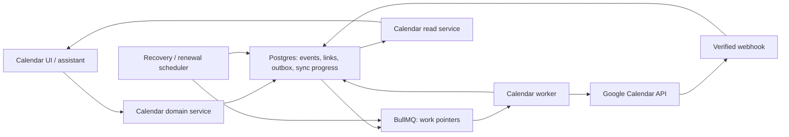

# Google Calendar two-way sync implementation plan

Date: 10 October 2026

Status: Implementation paused for account-owner Google testing

Scope: Optional Google Calendar integration for existing Sydia users

## 1. Intended outcome and product decisions

Users sign in to Sydia through their existing authentication method. They separately authorize Google Calendar access from Settings → Integrations. Google authorization does not create a Sydia account or become a required Sydia login method.

After connection, supported Google events appear in Sydia, and changes made through either Sydia's calendar UI or assistant reach Google. Changes made directly in Google reach Sydia without opening the frontend. Local reads remain available during provider outages, with an accurate freshness indicator.

Use these decisions as the implementation baseline:

| Decision                         | Proposed behavior                                                                                                                      |
| -------------------------------- | -------------------------------------------------------------------------------------------------------------------------------------- |
| Account/calendar count           | One connected Google account and one active writable calendar per Sydia user in the first release                                      |
| Calendar selection               | Default to the primary calendar, resolve its concrete ID, and allow selection of one other writable calendar during setup              |
| Event types                      | Regular Google events (`eventTypes=default`), including timed, all-day, and recurring events; disclose this supported scope            |
| Existing local events            | Remain local until the user explicitly chooses which events to export                                                                  |
| New events while connected       | Default to the active Google calendar; expose a local destination where users need it                                                  |
| Tasks                            | Keep Sydia tasks separate from Google Calendar events; appearing together in Sydia's calendar does not imply Google Tasks integration  |
| Simultaneous edits               | Merge independent changes; ask the user to resolve incompatible changes                                                                |
| Disconnect                       | Stop sync, retain local events and cached Google events, preserve unresolved edits, and revoke access                                  |
| Cached events after disconnect   | Linked Google events are read-only until reconnection; an explicit “Copy to Sydia” action creates a separate local event               |
| Account/calendar switch          | Establish a new binding; never reuse the old account's cursor, event IDs, or pending operations against the new calendar               |
| First release recurrence editing | Support “this occurrence” and “entire series”; keep “this and following” disabled until its series-splitting semantics are implemented |

Birthday, Gmail-derived, working-location, focus-time, and out-of-office events are outside the initial import scope. Do not advertise complete support for every Google event type. Later support must add mapping, permissions, and tests before widening the sync filter.

The current code contains the durable sync foundation, optional Google authorization, inbound/outbound workers, webhook handling with polling fallback, recurrence projections, all-day event editing, event destination selection, explicit export/copy actions, privacy export, and conflict comparison/resolution. Sydia login remains independent of Google OAuth.

Implementation progress as of 10 October 2026:

- `TokenCipher` now accepts only authenticated `v1` ciphertext. A bounded, dry-run-first `calendar:credentials:migrate` command inventories legacy `CalendarIntegration` token fields without logging values, validates existing ciphertext, and can encrypt legacy plaintext with compare-and-set updates. It must be run against the target database before deploying code that requires strict decryption; its production inventory and post-apply verification remain rollout gates.
- The schema migration marks legacy Google event rows without a verified binding as `reconnect_required` / `legacy_link_unverified`. During a pull for the verified account and concrete calendar, Sydia links an old row only when one candidate has the provider event ID and its full normalized snapshot exactly matches Google; this preserves the existing Sydia ID and revision. Changed or ambiguous candidates remain unlinked and recovery-required while Google is imported separately. Reconciliation considers at most 500 candidates per page and fails the page transaction above that bound for operator investigation.
- Conflict review is available from Integrations. The API returns normalized snapshots, and “keep Sydia” / “use Google” decisions check the current local revision and provider ETag. Local wins queue a durable conditional write; remote wins update Sydia in the same transaction that resolves the conflict.
- Conflict resolution pauses queued event operations, refuses stale comparisons, and waits while a write is actively processing. Focused repository tests cover remote wins, local wins, queued writes, and stale revision rejection.
- Integrations now lists writable Google calendars and lets users switch the active binding. Calendar access is revalidated with Google before selection; switching pauses the old binding's pending operations and selecting it again resumes them. Cached events from the inactive calendar stay available as read-only copies.
- Calendar-selection tests cover new binding creation, generation advancement, reactivation of a prior binding with paused operations, selecting the already-active calendar, and initial-pull dispatch.
- The calendar UI asks whether a recurring event change applies to one occurrence or the whole series. Google-backed actions resolve the provider instance by its original start time, verify the active binding, and persist the real instance identity before using the durable mutation outbox. Local-only series persist per-occurrence exception records keyed by original occurrence identity; projections overlay moved exceptions and suppress cancelled ones. These exception edits remain Sydia-only, consistent with the series destination.
- Assistant calendar reads now use the same recurrence projection as the calendar UI. Assistant edits and cancellations require explicit occurrence/series scope for recurring results; one-occurrence writes materialize local-only exceptions or resolve and verify the real Google instance before entering the outbox. The assistant also has a registered sync-status tool, and its calendar write instructions distinguish local-only, pending, confirmed, conflict, failed, and reconnect-required outcomes.
- Event details now expose per-event sync state, and the editor says when a change will be saved locally and queued for Google. Integrations already shows pending operation counts, conflicts, reconnect requirements, and provider errors.
- The event editor now offers a retry action for terminal Google write errors. It requeues the oldest outstanding durable operation after checking the current failed event revision, connection generation, and active calendar binding; its stable Google event ID and attempt history are preserved. The sync-status tool reports binding-level status; it must not be used as proof that one specific event reached Google.
- Local exception inheritance now records per-field overrides and projects unoverridden fields from the current series, including the occurrence's derived time group. The editor sends only changed fields so an unchanged form value does not become an override. A migration marks previously moved local exceptions as time overrides. Assistant create/update tools accept validated all-day date ranges with exclusive ends. Terminal acknowledgements state that the Sydia save completed, render inclusive all-day dates, and separately report Google delivery state in English and Indonesian. Unit coverage checks all six sync states and Web, Telegram, and WhatsApp formatting; authenticated local-only `/chats` previews and normal connected-owner conversations through the live assistant and Google provider remain staging gates.
- Outbound operations now separate lifetime attempts from the current automatic retry budget. Transient provider failures stop after the configured attempt or age limit; a user retry starts a fresh bounded window while retaining the lifetime attempt count. Shared-admission deferrals do not consume provider attempts.
- Operation, binding, and credential lease claims and expiry checks now use PostgreSQL's clock. Automatic and manual retry deadlines are calculated from database time, and operation retry-age checks use the database claim timestamp plus monotonic elapsed time. OAuth request expiry is resolved from PostgreSQL time inside its creation transaction; callback state/session checks use that same clock. Recovery due scans, watch-channel expiry, idempotency receipt expiry, inbound-page checkpoints, and Google occurrence materialization also use database time; a calendar page rolls back if its lease or dirty revision changes before its checkpoint commits.
- Watch-channel rows persist their connection generation. Notification receipt and watch activation fence against that saved generation, while recovery schedules a replacement if only stale-generation active or registering channels remain. The isolated PostgreSQL contract rotates the generation during an active watch and during registration, verifies that the old notification and late activation are rejected, and confirms recovery schedules the current generation.
- Disconnect fences the binding, pauses operations, advances the connection generation, and consumes pending OAuth state before remote cleanup. If Google token revocation fails, encrypted credentials remain available for retry while `disconnecting` blocks sync and reconnect; Integrations exposes a retry action and Prometheus exports a dedicated revocation-failure counter.
- Webhook persistence failure coverage now injects a PostgreSQL error after the channel message number advances but before the binding dirty revision commits. The transaction rolls back both records, and a service unit test confirms a repository failure propagates before queue dispatch.
- Calendar sync exports OpenTelemetry counters and histograms for Google API calls, admission wait, operation age, pull freshness, pages/events, work duration/outcome, lease loss, token refresh/revocation failures, watch renewal/cleanup failures, conflicts, and exhausted retries. One batched observable callback reads database aggregates for active outbox counts/oldest age, binding counts/oldest pull age, the oldest active binding without a successful initial pull, expiring watches, and pending cleanup/oldest cleanup age. Snapshot failures increment a bounded counter and propagate to the metrics reader. Export requires an explicitly configured `OTEL_METRICS_EXPORTER`; labels do not contain tenant or event identifiers. An importable Grafana dashboard and Prometheus alert rules now cover these instruments; environment scoping, the initial-import threshold, receiver delivery, and staging alert validation remain release gates.
- Watch stop failures, uncertain watch-creation results, disconnects, account changes, and calendar switches now persist `cleanup_pending` with a request timestamp. Notifications are rejected immediately; the pending gauge remains set until stop confirmation or provider expiry. A separate counter measures failed stop attempts. The system relies on Google's channel expiry after a stop failure; automated remote-stop retries after disconnect are not available once consent is revoked.
- Earlier local verification: after the final watch-registration lock, the full backend Jest suite passed 92 suites and 931 tests (16 suites / 62 tests skipped). The separate isolated PostgreSQL 18 + pgvector and Redis 8 contracts pass 19 tests, and all 42 migrations apply. The mocked calendar disconnect e2e passes on desktop and mobile (4 tests). The credential-migration CLI's dry run, apply, post-apply verification, and invalid-ciphertext guard pass against synthetic records; production inventory counts remain unmeasured. Prometheus validates all seven alert rules and their firing/gating behavior, and the dashboard JSON parses with 12 panels. Backend and frontend typechecks, full backend and frontend lint, both production builds, Prettier, and `git diff --check` pass. These local checks do not establish production-scale behavior.
- `BACKEND_GOOGLE_CALENDAR_SYNC_ENABLED` now defaults to false. When off, status exposes Google as unavailable, Google-specific connect/select/export/retry endpoints reject work, sync/recovery/webhook jobs stop before provider calls, and transport methods guard against direct calls. Enabling validates OAuth credentials and the redirect URL at startup. Explicit disconnect can still revoke consent while remote watch cleanup is skipped. Durable work remains in Postgres for recovery after re-enable. See the operator procedure in [the Google Calendar sync runbook](./runbooks/GOOGLE_CALENDAR_SYNC.md).
- A draft operator runbook now covers quota exhaustion, Redis outage, rejected tokens, stuck leases, failed imports, invalid cursors, watch renewal, and account/calendar misbinding. Admins can request a user-scoped full import at `POST /calendar/admin/users/:userId/full-resync`; the repository resets only the active binding's cursor under its lease fence and preserves pending outbound operations. Opt-in live contracts have passed on isolated PostgreSQL with pgvector and Redis instances: they verify concurrent binding claims, atomic page rollback and cursor commit, expired-lease takeover with stale-worker fencing, durable outbox recovery after queue dispatch failure, reconciliation of a provider create after a simulated database commit failure without duplicating the remote event, watch notification handling before channel registration completes, notification/activation and registration/disconnect races across independent Prisma clients, dirty-revision recovery after webhook queue dispatch failure, and persisted cleanup gauges across disconnect. The webhook contract also checks concurrent duplicate receipts, token/resource/message-number rejection, stopped-channel rejection, and durable dirty-revision advancement. Redis checks cover cross-client shared lane caps, reserved interactive capacity, and bounded fail-closed behavior when Redis is unreachable. The limiter also waits up to 500 ms for Redis's initial ready event before failing closed. Remaining release gates include validation under the deployed multi-process topology, multi-replica fairness and rate-limit validation, load/SLO measurements, dashboard/alert deployment and staging validation, staged runbook/rollback validation, real-provider staging, and assistant cross-channel confirmation. These local contracts do not establish production-scale behavior.

- Agenda recurrence identities now include the authoritative calendar binding. Moved exceptions and cancellation tombstones from an inactive calendar cannot overlay a series with the same Google ID in the active calendar; unverified legacy exceptions remain separate. Regression tests failed against the previous grouping, and two isolated PostgreSQL contracts exercise actual imports and a calendar switch.
- Timed recurrence reads preserve UTC and timezone-qualified RDATE/EXDATE instants, including both instances of a repeated DST wall time. UTC UNTIL is checked after projection so a cutoff during a DST overlap uses instant ordering. Invalid recurrence clock fields fail visibly rather than normalizing. UTC exclusion/addition/cutoff regressions failed before their fixes.
- Continuation verification: all 42 migrations apply to a fresh disposable PostgreSQL 18 + pgvector database. The isolated PostgreSQL/Redis 8 contracts pass 21 tests, including the two new calendar-switch agenda contracts. The full backend suite passes 92 suites / 942 tests, with 16 suites / 64 tests skipped (live store contracts were run separately). Backend production build, backend/frontend typechecks, affected backend lint, Prettier, and `git diff --check` pass. All 30 mocked calendar and chat-preview Playwright checks pass on desktop/mobile using an isolated fixture server on port 3117; the initial run against the pre-existing server on 3110 timed out during page loading. The staging/provider and load gates remain unverified.
- Enabled recovery now performs indexed, bounded cleanup of completed operations after 30 days, expired OAuth requests, and expired mutation receipts. Retention days and per-table batches are configurable with validated bounds. PostgreSQL time, `SKIP LOCKED`, and a single atomic statement fence concurrent sweeps; unexpired retry receipts protect their referenced completed operations. Failed and other unfinished operations, conflict history, event snapshots, and recurring cancellation identities remain intact. Ordinary tombstone cleanup is described in the later continuation below; resolved-conflict retention still requires a separate policy. Metrics expose removal counts by record kind, and the dashboard and eighth alert cover cleanup failures. See [retention cleanup](./runbooks/GOOGLE_CALENDAR_SYNC.md#retention-cleanup).
- Retention continuation verification: all 43 migrations apply to a fresh disposable PostgreSQL 18 + pgvector database. The isolated PostgreSQL/Redis contracts pass 25 tests, including bounded retention, receipt protection, database-clock expiry, concurrent sweeps, and atomic rollback on an injected delete error. The full backend suite passes 92 suites / 951 tests (16 suites / 68 tests skipped; store contracts ran separately). Backend typecheck, production build, affected-file lint, Prisma formatting, Prettier, and `git diff --check` pass. Prometheus validates all eight rules and their firing/gating tests; the dashboard JSON contains 13 panels. Disposable test stores were removed. Real-provider, deployed-topology/load, and staged alert-delivery checks remain unverified.
- Ordinary remote tombstone retention is now configurable (90 days by default), indexed, and bounded within the same atomic recovery cleanup transaction. Owner/link locks and a fresh dependency check fence concurrent mutation and inbound writes. Recurring cancellations and series identities, any conflict history, unexpired retry receipts, unsettled local events, and all unfinished operation references protect links from deletion. Stable remote IDs and payload references are checked within their own binding. Cancelled event snapshots remain available. Resolved-conflict retention still requires a separate policy.
- Tombstone continuation verification: all 44 migrations apply to the fresh disposable PostgreSQL 18 + pgvector database. The isolated PostgreSQL/Redis contracts pass 41 tests, including 16 new tombstone cases for expiry, snapshot preservation, recurrence, conflict history, unfinished states, remote identities, receipts, active locks, and busy-owner progress. The full backend suite passes 92 suites / 953 tests (16 suites / 84 tests skipped; live contracts ran separately). Backend typecheck, production build, affected-file lint, Prisma formatting, Prettier, and `git diff --check` pass. The new ordinary-cleanup expectations and busy-owner regression failed before their fixes; their final live contracts pass. Disposable test stores were removed. Provider staging, deployed-topology/load checks, alert delivery, and rollout gates remain unverified.
- Outbound completion now confirms cancellations in the event and link baseline atomically instead of leaving their event state pending. Only a matching pending revision is marked synced; newer pending edits and surfaced conflict/error states survive older write acknowledgements. Completion uses the owner lock and rechecks binding/generation/claim state after it, and a delete whose local event was removed resolves only its saved remote identity. A missing identity cannot select an arbitrary unlinked event. Provider success followed by database completion failure now logs at ERROR with a redacted error code, records a failed operation job, and propagates for recovery of the same durable operation. The [operator guidance](./runbooks/GOOGLE_CALENDAR_SYNC.md#provider-success-followed-by-database-completion-failure) distinguishes pending confirmation from provider delivery and explains retry limitations for conditional updates.
- Completion continuation verification: all 44 migrations apply to a fresh disposable PostgreSQL 18 + pgvector database. The isolated PostgreSQL/Redis contracts pass 51 tests, including ten new completion cases covering cancelled-event confirmation, persisted baselines, newer pending/conflict/error revisions, stale claims, disconnect fencing, removed local references, missing identities, and atomic rollback on an injected event-update failure. Five regression cases failed before their fixes; the service's completion-failure logging/metrics and raw-error redaction assertions also failed before implementation. The full backend suite passes 92 suites / 954 tests (16 suites / 94 tests skipped; live contracts ran separately). After the final logging redaction, the focused service/repository suites pass 40 tests; the backend typecheck, production build, affected-file lint, Prettier, and `git diff --check` pass. Disposable test stores were removed. The completion fixture uses an explicitly past due time to avoid a sub-millisecond timestamp boundary; expanded table-case expectations were corrected to use their specified revision/state. The real-provider, deployed-topology/load, alert-delivery, and rollout gates remain unverified.
- Conditional updates now read the latest Google resource and reconcile the immutable operation baseline, desired local fields, and current provider fields. Independent changes survive; same-value convergence completes without another PATCH or guest notification; incompatible changes persist the exact compared snapshot and field groups. Time/date range and recurrence are coupled, as is attendee membership. PATCH sends only remaining changes, requires the current ETag, and records the private operation marker. A `412` permits one fresh read and then convergence, conflict, or bounded `calendar_version_changed` retry; a claim sends at most one PATCH. A marker alone cannot overwrite a later provider edit. Empty provider strings confirm cleared optional fields, and tentative status is preserved.
- Update completion atomically saves the normalized provider baseline and imports independent provider fields only into the matching pending revision. When reconciliation advances the local revision, the link's confirmed revision advances with it; otherwise inbound cancellation could mistake a delivered event for outstanding local work. Newer queued edits retain their immutable deltas. Failed earlier operations block dependent revisions, and manual retry selects the oldest outstanding intent while preserving newer local edits and lifetime attempt history. User conflict resolution supersedes obsolete failures, so “keep Sydia” and later edits after “use Google” can proceed without replaying superseded operations.
- Update-reconciliation continuation verification: all 44 migrations apply to a fresh disposable PostgreSQL 18 + pgvector database. The isolated PostgreSQL/Redis contracts pass 57 tests, including six new update/dependency/resolution cases using real persistence and a synthetic Google transport; an injected SQL trigger proves atomic rollback after provider acceptance. Six service regressions, the resolved-operation blocking regression, and the confirmed-link revision regression failed before their fixes. The full backend suite passes 93 suites / 976 tests (16 suites / 100 tests skipped; live contracts ran separately). After the final confirmed-link revision refinement, the focused transport/service/reconciliation/repository suites pass 63 tests and all 57 live contracts pass. Backend typecheck, production build, affected-file lint, Prettier, and `git diff --check` pass. Disposable stores were removed. The runbook includes the focused verification command and recovery behavior; the staging checklist adds independent edits and accepted-update recovery. Real Google PATCH/invitation/metadata checks, authenticated channel previews, deployed topology/load, alert delivery, and rollout gates remain unverified.
- Worker Calendar API requests now revalidate their operation/binding claim after shared admission and immediately before HTTP dispatch. The PostgreSQL check includes active account/binding, generation, token/owner and epoch, and a 20-second remaining lease budget for the 15-second transport timeout. Credential refresh checks both its work guard and integration credential lease before calling the token endpoint. Rejection logs `calendar_request_fenced`, releases admission, and defers recoverable work without spending provider attempts. A disconnected or replaced claim cannot save failure/completion state. Compensation to stop a late, fenced watch registration remains a deliberate cleanup exception; already-issued requests can still finish after disconnect. Watch cleanup errors now log redacted codes instead of raw provider stacks/messages.
- Request-fencing continuation verification: all 44 migrations apply to a fresh disposable PostgreSQL 18 + pgvector database. The isolated PostgreSQL/Redis contracts pass 68 tests, including 11 new cases for expired/replaced/paused operation claims, epochs/generations, insufficient HTTP time, disconnect, binding and credential claims, disconnect between GET/PATCH, and lease-budget deferral without consuming operation attempts. The admission-fence transport regression failed before implementation. The full backend suite passes 93 suites / 978 tests (16 suites / 110 tests skipped; live contracts ran separately). After final logging refinements, the transport/sync/OAuth suites pass 46 tests and all 68 isolated contracts pass. Typecheck, production build, affected-file lint, Prettier, and `git diff --check` pass. Watch logging assertions now require redacted error codes and reject raw error messages. Request-boundary fixtures use distinct synthetic project keys because repeated runs had exhausted their shared Redis bucket before reaching the intended lease check; the corrected contracts exercise the lease boundary. Disposable stores were removed. Real Google, authenticated channel previews, deployed topology/load/fairness, alert delivery, suspend/rollback, credential migration, and rollout gates remain unverified.
- Inbound reconciliation now treats timed/all-day bounds, timezone, and recurrence as one coupled group in both new and refreshed conflict comparisons. Different concurrent time-group edits preserve the complete local schedule and remote snapshot instead of creating a hybrid interval or pairing local dates with a different Google rule. Independent fields still merge and identical changes converge. Attendee and recurrence ordering is insignificant, and cleared optional strings normalize consistently with outbound comparison. A pending local cancellation conflicts with a new remote edit; matching cancellations converge and repeated cancellation pages preserve the confirmed revision. These fixes close inbound gaps independently of the outbound reconciliation already described above.
- Inbound continuation verification: all 44 migrations apply to a fresh disposable PostgreSQL 18 + pgvector database. All 80 isolated PostgreSQL/Redis contracts pass, including 12 new cases for coupled time conflicts, refreshed comparisons, same-value convergence, independent merging, timezone/all-day/recurrence changes, harmless list ordering, cleared optional strings, and cancellation races. Five regression cases failed before the fixes. The strengthened refresh case also passes and verifies reuse of the existing conflict record with the latest remote schedule. The full backend suite passes 93 suites / 978 tests (16 suites / 123 tests skipped; live contracts ran separately). Backend typecheck, production build, affected-file lint, Prettier, and `git diff --check` pass. Disposable stores were removed. The staging checklist includes a real-provider coupled-time conflict check. Real Google, authenticated channel previews, deployed topology/load/fairness, alert delivery, suspend/rollback, credential migration, and rollout gates remain unverified.
- Incremental pagination now retains the original sync token alongside each persisted page token, as required by [Google’s synchronization guide](https://developers.google.com/workspace/calendar/api/guides/sync). The previous continuation request dropped that token; its corrected regression failed against the old code. The 41 focused sync/transport tests pass, including unchanged request filters and a full-import continuation without a sync token. Persistence already keeps the old token until the final page commits. Backend typecheck, production build, affected-file lint, Prettier, and `git diff --check` pass. Real-provider multi-page synchronization and restart recovery remain staging gates.
- Completed full-resync imports now reconcile absent linked events through the same minimal-cancellation path as ordinary inbound deletion. Matching pending cancellations converge without an extra revision; open conflicts survive even when their revision equals the synced baseline, and disappearance refreshes the existing comparison instead of adding another open conflict. The three PostgreSQL regressions failed before the fix and pass after it. A missing provider event clears the obsolete ETag in its comparison. Real-provider scoped-resync verification remains a staging gate.
- Full-resync continuation verification: all 44 migrations apply to a fresh disposable PostgreSQL 18 + pgvector database. All 83 isolated PostgreSQL/Redis contracts pass. The three new full-resync regressions failed against the previous implementation; after the fix and a final obsolete-ETag assertion they pass. The full backend suite passes 93 suites / 980 tests (16 suites / 126 tests skipped; live contracts ran separately). Backend typecheck, production build, affected-file lint, Prettier, and `git diff --check` pass. Disposable stores were removed. The runbook documents absent-event reconciliation and its targeted command; the staging checklist includes scoped-resync deletion comparisons. Real Google, authenticated channel previews, deployed topology/load/fairness, alert delivery, suspend/rollback, credential migration, and rollout gates remain unverified.
- Full-import finalization now processes at most 100 absent links per job with a durable link cursor and pending final sync token. Batches commit atomically and release their lease; recovery resumes without another provider read. The captured dirty revision remains fixed, so notifications arriving between batches remain due. Final freshness and the incremental sync token advance only after the last batch. Nullable legacy import-generation markers are included in missing-event reconciliation. Migration `20261010230000_calendar_import_finalization` adds the checkpoints and a partial binding/link index. The new backend and workers require that migration before startup.
- Finalization continuation verification: all 45 migrations apply to the fresh disposable PostgreSQL 18 + pgvector database, including the new finalization checkpoints. All 86 isolated PostgreSQL/Redis contracts pass, including bounded 100-link commits, replacement-worker resumption, dirty notifications between batches, rollback on an injected batch-commit failure, and missing links with a null import generation. The initial bulk fixture exposed the nullable-marker omission; the final bounded fixture uses an explicit prior generation to distinguish batching from that separate defect. The focused service/repository suites pass 53 tests, including provider-free continuation. The full backend suite passes 93 suites / 981 tests (16 suites / 129 tests skipped; live contracts ran separately). Backend typecheck, production build, affected-file lint, Prisma formatting, Prettier, and `git diff --check` pass. Disposable stores were removed. Work is paused at the account owner’s request, awaiting Google test results; real-provider, authenticated channel, deployed topology/load/fairness, alert-delivery, suspend/rollback, credential migration, and rollout gates remain unverified.
- The account owner will perform real Google authorization and provider smoke checks. Preparation, exact configuration names, expected outcomes, and a result template are in [the staging checklist](./runbooks/GOOGLE_CALENDAR_STAGING_CHECKLIST.md). `/chats` sandboxes intentionally have no Google credentials; authenticated previews verify local-only channel wording, while provider delivery states must be checked through normal connected-owner conversations.

## 2. Current repository behavior and gaps

The existing integration already provides Google consent, access-token refresh, encrypted token storage, connection status, disconnect, and outbound event CRUD.

| Existing source                                                                         | Behavior and implementation impact                                                                                                                                                                                                         |
| --------------------------------------------------------------------------------------- | ------------------------------------------------------------------------------------------------------------------------------------------------------------------------------------------------------------------------------------------ |
| `apps/backend/prisma/schema.prisma`                                                     | `CalendarIntegration` is unique by user/provider and defaults to the `primary` alias. `CalendarEvent` stores timed values and has a unique user/provider/event-ID constraint. Add explicit account/calendar identity and sync persistence. |
| `apps/backend/src/infra/calendar/google-calendar.service.ts`                            | Wraps OAuth and Google create/update/delete. Add typed reads, pagination, conditional writes, watch/stop operations, timeouts, and structured provider errors.                                                                             |
| `apps/backend/src/modules/calendar/calendar.service.ts`                                 | Performs Google writes before local persistence. Replace this with an atomic local mutation plus durable outbound operation.                                                                                                               |
| `apps/backend/src/modules/calendar/calendar.controller.ts`                              | Reads events from the local repository. Callback saves tokens and redirects to a relative `/calendar` URL. Extend lifecycle endpoints and use a configured frontend return URL.                                                            |
| `apps/backend/src/database/repositories/prisma-calendar.repository.ts`                  | Owns calendar persistence and uses `TokenCipher`. Add atomic mutation/outbox operations and repositories for new sync records.                                                                                                             |
| `apps/backend/src/infra/queue/queue.service.ts` and `apps/backend/src/worker.ts`        | Existing BullMQ/Redis queues and workers can host calendar jobs. Calendar retries need a provider-aware policy rather than inheriting generic retry behavior unchanged.                                                                    |
| `apps/frontend/src/components/settings/integrations-page.tsx`                           | Already exposes connection/disconnect. Its current “two-way sync” description exceeds the backend's capabilities.                                                                                                                          |
| `apps/frontend/src/lib/services/api/calendar/calendar.api.ts` and `calendar.queries.ts` | Already provide requests, query keys, and mutation invalidation. Extend event/status contracts and add refresh after background changes.                                                                                                   |
| `apps/backend/src/modules/conversations/services/phase-tools.ts`                        | Assistant reads use `CalendarReadService`; writes use `CalendarService`, explicit recurrence scope, and provider-instance resolution. Add channel validation and a user recovery action for exhausted writes.                              |
| `apps/backend/src/modules/users/services/user-privacy.service.ts`                       | Revokes Google tokens during account deletion. Extend cleanup to channels, pending operations, bindings, and snapshots.                                                                                                                    |

Correct these existing failure cases as part of the implementation:

- An expired or incomplete connected credential can currently return `null`, allowing a new event to silently become local-only.
- The Google response parser substitutes an empty object after a JSON parse failure and discards useful error reasons.
- OAuth state contains a signed user ID and timestamp, without a stored one-time request or browser binding. Its parser also needs strict timestamp validation.
- OAuth state signing has a development-secret fallback. Enabled production integration must require valid configured secrets.
- Before deploying strict `TokenCipher.decrypt`, run `calendar:credentials:migrate` against the target database with a compatible backup: first without flags to inventory, then with `--apply`, then again without flags to confirm zero plaintext and zero invalid versioned fields. The command is resumable after interruption and refuses to overwrite a row changed concurrently. Do not change `BACKEND_TOKEN_ENCRYPTION_KEY` / `BACKEND_AUTH_SECRET` between migration and deployment; key rotation is a separate re-encryption procedure. Production counts have not been measured from this repository checkout.

Audit all calendar consumers, including assistant reads, today's agenda, briefings, notification composition, privacy export, and existing tests. Route occurrence reads through the same domain contract so these consumers agree with the UI.

## 3. Architecture and delivery guarantees



Postgres owns the durable record of pending work. Redis carries dispatch and shared throttling. Redis loss must not erase an accepted user edit or a webhook's recorded request to sync.

Use delivery that may repeat jobs, with idempotent processing. Do not promise exactly one execution across Postgres, Redis, and Google. Correctness comes from stable event identity, operation identity, local revisions, conditional Google writes, and repeatable imports.

Separate responsibilities:

- Infrastructure owns Google transport, token exchange/verification, and queue construction.
- Calendar domain services own destination selection, import decisions, conflicts, recurrence semantics, and lifecycle rules.
- Repository contracts own atomic persistence, operation claiming, cursor commits, and lease fencing.
- Controllers own validation, authentication boundaries, and the existing response envelope.
- The worker owns bounded processing, retries, renewal, and recovery scheduling.

Follow existing relative imports, barrels, named exports, and strict typing. Feature services do not import Prisma or concrete repository adapters. Add provider bindings in `CalendarModule` and export only services with actual cross-module callers.

## 4. Persistence changes

Add an additive migration first. Keep existing fields readable during deployment; remove obsolete fields only after callers and migrated data use the new model.

| Record                        | Required additions or proposed fields                                                                                                                                                                                                                                                | Invariant                                                                                                                                                      |
| ----------------------------- | ------------------------------------------------------------------------------------------------------------------------------------------------------------------------------------------------------------------------------------------------------------------------------------ | -------------------------------------------------------------------------------------------------------------------------------------------------------------- |
| `CalendarIntegration`         | Verified Google subject, account display email, granted scopes, authorization state, connection generation, encrypted tokens, last authorization error                                                                                                                               | Authorization state is independent of sync freshness. New authorization/account replacement advances the generation; ordinary access-token refresh retains it. |
| New `CalendarBinding`         | Integration ID, immutable Google subject and concrete calendar ID, display name, timezone, active state, query-version signature, sync token, page checkpoint, full-import generation, dirty/completed revisions, last successful pull, next recovery time, lease owner/expiry/epoch | One active binding per integration. Account/calendar identity never changes in place.                                                                          |
| `CalendarEvent`               | Local revision; timed/all-day discriminator; date-only bounds; tentative status; recurrence definition and timezone; series/exception identity; deleted timestamp; user-facing sync state                                                                                            | Validate exactly one temporal representation. Local revision increases on user mutation, including cancellation.                                               |
| New `CalendarEventLink`       | Binding ID, Google event ID, optional local event ID, remote ETag, remote normalized snapshot, last common snapshot, synced local revision, last-seen full-import generation, recurrence-parent/original-start identity, tombstone metadata                                          | Unique `(bindingId, googleEventId)`. Remote tombstones can exist without a complete local event.                                                               |
| New `CalendarSyncOperation`   | Binding ID, connection generation, event/link ID, operation ID, local revision, operation kind, immutable desired-field patch, base version, stable remote-create ID, execution state, attempts, next-attempt time, timestamps, typed last error                                     | Saving a linked user edit and its operation is one transaction. Queue payloads reference this record.                                                          |
| New `CalendarMutationReceipt` | Sydia user ID, client request key, operation scope, normalized request fingerprint, accepted-result reference, creation/expiry timestamps                                                                                                                                            | Local HTTP retries cannot create a second event or export operation, including for local-only events.                                                          |
| New `CalendarWatchChannel`    | Binding/generation, unique channel ID, secret-token hash, resource ID, actual expiry, registration/retirement state, notification audit metadata                                                                                                                                     | Multiple channel rows support overlapping renewal. No channel token contains OAuth credentials.                                                                |
| New `CalendarSyncConflict`    | Link ID, local revision, base/local/remote snapshots, conflicting field groups, deletion state, resolution/audit fields                                                                                                                                                              | Both versions survive. Resolution checks that the conflict has not changed.                                                                                    |
| New `CalendarOAuthRequest`    | Hashed random state, initiating Sydia user/session reference, browser nonce hash, ID-token nonce, expiry, consumed timestamp, allowlisted return target                                                                                                                              | One-time, expiring, browser-bound authorization request.                                                                                                       |

Implement database constraints and indexes for active bindings, remote identity, due operations, due recovery, expiring channels, unresolved conflicts, lease expiry, and tenant/event-range reads. Use keyset pagination for recovery sweeps.

Retain `provider` and `providerEventId` temporarily as compatibility projections from links; define one authoritative write path. Replace the existing event-ID uniqueness rule after backfill with binding-scoped identity so IDs from different calendars cannot collide.

Do not force incomplete cancellation payloads into required title/start/end fields. Preserve minimal remote tombstones separately. Keep ordinary tombstones until configured retention expires and no pending operation references them; retain recurring cancellation exceptions for the series lifetime.

## 5. Event representation and recurrence

Use a discriminated domain type for timed and all-day events. Preserve all-day dates as calendar dates, with an exclusive end date. Do not treat an all-day date as a browser-local midnight timestamp. Google distinguishes `date` from `dateTime` and uses original-start identity for recurring exceptions. [Google event resource reference](https://developers.google.com/workspace/calendar/api/v3/reference/events).

Persist recurring masters and exceptions as canonical records. Google exceptions retain their provider instance identity; Sydia-only exceptions use a self-referencing local-series ID and a unique original occurrence key. Produce occurrence projections only for a bounded requested range, using stable occurrence keys. Derived occurrence fields are not independent copies that can be pushed as new Google events. Local exceptions inherit the Sydia-only destination; exporting a series changes it to a Google-backed series whose single-occurrence actions resolve through Google's instance API. Sydia-only exceptions store a list of overridden field groups (`title`, `description`, `location`, `attendees`, `time`, and `status`). Reads overlay every unoverridden group from the current series; `time` is treated as one group and follows the occurrence projection. This avoids a write fan-out when a large series changes. The editor submits only fields the user changed, so inherited values included in a form do not accidentally become overrides. When a series edit removes an exception's original occurrence identity, retain that exception as a standalone local event at its last effective time; never silently delete or re-key it. The additive migration backfills legacy moved exceptions as time overrides.

Create a `CalendarReadService` exported through the calendar module. It returns dated occurrences for the frontend, assistant, agenda, and briefing callers. For series beginning outside the requested range, selection must still consider recurrence bounds; a simple master `startAt` filter is insufficient.

Evaluate the existing `rrule` dependency against real Google fixtures before choosing its expansion strategy. Cover IANA timezones, DST transitions, all-day series, RDATE/EXDATE, moved occurrences, and cancellations. Set explicit range and occurrence-count limits; an exceeded limit returns an actionable typed result rather than a silently truncated agenda.

For imported series, carry the Google instance identity needed to modify one occurrence. Resolve a virtual occurrence through Google's instance API when needed, rather than assuming Sydia can synthesize a valid provider ID. “Entire series” targets the master. Google describes these separate operations in its [recurring-events guide](https://developers.google.com/workspace/calendar/api/guides/recurringevents).

The first release may limit recurrence authoring to rules the editor supports. Preserve imported rules and expose unsupported editing as read-only with “Open in Google Calendar”; never replace an unfamiliar rule with a simpler default.

Tentative events remain visible with their status. Missing summaries are legitimate and can render as “Untitled event,” while preserving the remote value. Missing required dates on a live event are a mapping failure and must remain observable.

Preserve provider metadata such as organizer, attendee response state, privacy, reminders, and conference data. Sydia patches only fields the user changed and is permitted to edit. Email-only attendee inputs must not replace rich imported attendee objects indiscriminately. Restricted event fields remain read-only.

## 6. OAuth, identity, and connection setup

1. Require an authenticated Sydia session to begin connecting. Convert the existing connect request to a POST because it creates a persisted authorization request.
2. Generate opaque random state, a browser nonce, and an ID-token nonce. Store hashes and expiry, set a secure HttpOnly browser cookie suitable for the deployed frontend/backend topology, and bind the request to the initiating user/session.
3. Request the existing `calendar.events` scope, `calendar.calendarlist.readonly` for calendar selection, and `openid email` to identify and label the connected Google account. Calendar list access needs its own authorized scope. [CalendarList authorization reference](https://developers.google.com/workspace/calendar/api/v3/reference/calendarList/list).
4. Request offline access. Handle denied or partially granted consent and absence of a usable refresh token explicitly. Retain a previous refresh token only for a verified matching account.
5. Put the callback on a deliberately anonymous controller, separate from the user-role controller. It still requires valid state and browser binding, and the initiating Sydia user/session must remain active; anonymity does not authorize arbitrary account linking. If the session expired, require normal Sydia sign-in and restart the connection. Atomically consume state and exchange the code server-side.
6. Use a maintained Google OAuth verification library to verify the ID token, including signature, audience, issuer, expiry, and expected nonce. Persist the verified `sub` as account identity; display email is not the identity key. Google's [backend token verification guide](https://developers.google.com/identity/sign-in/web/backend-auth) describes the core checks.
7. Store tokens through `TokenCipher`, record actual granted scopes, and advance the connection generation. Return to an allowlisted frontend URL configured on the server. Do not accept arbitrary redirect URLs from request parameters.
8. Fetch calendar choices, select one writable calendar, and persist a binding with the concrete ID. Recheck access on selection. Default to the primary entry without storing the `primary` alias as durable identity.
9. Persist an initial-sync request and register the watch channel; surface setup progress. Do not claim the calendar is synchronized just because tokens were saved.

Use shared credential-refresh coordination per integration, with generation checks when saving refreshed tokens. An authorization problem becomes `reconnect_required`; it must not silently change the selected destination to local. Google's [server OAuth guide](https://developers.google.com/identity/protocols/oauth2/web-server) supports offline access and server-side token exchange.

Enable the Calendar API, configure consent/redirect URIs, and complete the applicable production verification before broad rollout. Review Google OAuth policy and refresh-token lifetime behavior for the configured publishing status and account type; test credentials are not a production availability guarantee. [OAuth policies](https://developers.google.com/identity/protocols/oauth2/policies), [token expiration guidance](https://developers.google.com/identity/protocols/oauth2#expiration).

Do not write integration credentials into Better Auth-owned account tables or change Sydia's login providers.

## 7. Initial import and inbound incremental sync

Use one versioned query definition per binding: initially `singleEvents=false`, `showDeleted=true`, `eventTypes=default`, and a bounded page size. Avoid a moving date filter on the canonical mirror; project requested dates locally. Google's sync-token requests prohibit parameters including `timeMin`, `timeMax`, `orderBy`, and `q`. [Events list reference](https://developers.google.com/workspace/calendar/api/v3/reference/events/list).

Initial import:

1. Claim the binding lease and verify its active identity and connection generation.
2. Capture the requested dirty revision and begin a full-import generation.
3. Fetch one page through the shared request limiter.
4. Validate and map each resource. Upsert by binding/event identity; apply remote changes through the import path, never through the user-mutation path.
5. Persist page progress and imported records under the lease epoch. Yield between bounded page chunks so a large calendar does not monopolize capacity.
6. After every page is durable, reconcile records absent from the completed full mirror. Protect local-only records, pending edits, unresolved conflicts, and recurring exceptions.
7. Commit the final sync token, success time, and completed dirty revision. A notification received during the run leaves a higher dirty revision and triggers another pull.

Google provides the next sync token on the final page and includes deleted entries in incremental results. [Incremental synchronization guide](https://developers.google.com/workspace/calendar/api/guides/sync).

Subsequent runs use the last committed token. A paginated incremental run retains its original token and query signature across all pages. Checkpointing may resume a page, but must never publish a partially completed token as the next committed cursor.

For a crash after page persistence, replay is safe because imports are idempotent. If a page checkpoint is unusable, restart from the committed cursor or a full generation as appropriate. If a live resource cannot be mapped, record its identity and typed failure and block success/cursor advancement until corrected. Unsupported event types are excluded by the declared query rather than dropped silently.

When Google invalidates the cursor, rebuild a scoped remote mirror in a new full-import generation. Keep the current view available but marked stale; do not wipe the user's calendar or discard pending edits. Reconcile missing records only after the rebuild completes.

On each imported event:

- With no pending local edit, apply the normalized remote version and update the common snapshot.
- With pending edits, compare against the common snapshot and merge or create a conflict.
- For a cancellation, apply the deletion rules in section 9.
- For unchanged content, update relevant provider version metadata without creating an outbound operation.

Do not use calendar titles, event titles, email, or start time as identity matching heuristics.

## 8. Durable outbound mutations

Refactor the existing create/update/cancel flow:

1. Validate the full resulting event, including a partial time update combined with persisted values, permissions, destination, recurrence scope, and expected local revision.
2. In one repository transaction, check/reserve the client mutation key, persist the user mutation, increment its local revision, insert an immutable outbound operation for the exact binding and connection generation, and record the accepted result.
3. Return the saved event with `syncState=pending`. A local-only mutation returns `syncState=local` and schedules no provider operation.
4. Attempt dispatch using a pointer-only queue job. If Redis is unavailable after the transaction commits, record/log dispatch degradation and let indexed outbox recovery enqueue the existing operation. Do not report that the local save failed or invite duplicate submissions.
5. The worker verifies operation state, active binding, generation, permissions, and lease before sending the request.
6. Save the provider response, remote version, and operation result atomically. Advance the synced revision only for the revision actually sent; preserve newer local edits.

Create and export requests carry an `Idempotency-Key` that the frontend retains across network retries. Scope receipts to the authenticated Sydia user and action, verify a request fingerprint, and reject reuse with different content. A repeated accepted request returns its existing result without repeating the mutation. Apply the same protection to assistant tool retries using a stable tool-execution key. Mutation-receipt retention must cover the documented client retry window.

Each local-create operation reserves a stable provider ID before contacting Google. Use a compliant encoding such as a random UUID without hyphens, and attach a private Sydia operation/link marker. Google allows supplied IDs with defined character and length restrictions. On a duplicate-ID response, fetch and verify the marker before treating it as the result of an earlier attempt. An unrelated collision is a visible integrity failure. [Google event insertion reference](https://developers.google.com/workspace/calendar/api/v3/reference/events/insert).

Serialize operation order for one linked event. Keep immutable operation patches and local revision guards so an older worker response cannot overwrite a newer edit. Initially avoid aggressive operation coalescing; add it only with proof that create/update/delete and attendee notification semantics remain correct.

For a timeout after a write, reconcile the remote event before repeating the write. Compare the desired patch, marker, ETag, and common snapshot. An accepted write followed by a failed local commit must be recoverable without duplicating the event or replaying guest invitations unnecessarily.

Define attendee side effects explicitly. User-authorized guest creation or changes use the appropriate `sendUpdates` policy; import reconciliation sends no invitations. Existing-event export starts with guestless local events, while guest-bearing export needs a visible confirmation of invitation behavior. Google documents consequences of suppressing guest updates. [Insertion notification options](https://developers.google.com/workspace/calendar/api/v3/reference/events/insert).

For edits targeting Google during `reconnect_required`, allow an explicit save-as-pending contract and surface that it cannot sync until reconnection. Never silently detach the event or change its destination.

## 9. Conflicts, cancellation, and resynchronization rules

Maintain a common normalized snapshot after each successful reconciliation. Treat the time definition—start, end, timezone, all-day state, and recurrence—as one coupled field group. Treat attendee membership as a group rather than merging unrelated email arrays blindly.

Use conditional remote writes with `If-Match`. A Google `412` means the remote version changed and requires fetching and reconciling the latest resource. [Google resource version guide](https://developers.google.com/workspace/calendar/api/guides/version-resources).

| Situation                                          | Required behavior                                                                                                   |
| -------------------------------------------------- | ------------------------------------------------------------------------------------------------------------------- |
| Local title changed; remote location changed       | Merge both and conditionally send only the remaining local delta                                                    |
| Both sides set the same value                      | Accept convergence without a conflict                                                                               |
| Both sides change the same field group differently | Store a conflict and pause that event's outbound changes; other events continue                                     |
| Google deletes an event with no pending local edit | Tombstone the link and hide the event from normal reads                                                             |
| Google deletes an event with a pending local edit  | Preserve the edit and surface delete-versus-edit conflict; do not silently recreate                                 |
| Sydia deletes an event changed in Google           | Require conditional deletion; retain both versions if the condition fails                                           |
| Google already accepted a Sydia deletion           | Complete the operation after confirming absence within an accessible binding                                        |
| Cancelled recurrence exception                     | Keep its original occurrence identity and suppress that occurrence without deleting the series                      |
| Calendar access disappears                         | Pause the binding and preserve cached data; do not interpret access failure as deletion of every event              |
| Remote event moves to another calendar             | Represent its removal from the selected calendar; importing the destination requires a separately supported binding |

Google cancellations may contain only an ID, or minimal series/occurrence fields. Mapping must accept those shapes. [Event cancellation reference](https://developers.google.com/workspace/calendar/api/v3/reference/events).

Conflict resolution offers Google version, Sydia version, or a supported manual merge. Resolving a deletion in favor of keeping local content creates a new remote event only through an explicit user action. Require the conflict version and current local revision; reject a stale decision and refresh its comparison.

Do not select a winner using Sydia's `updatedAt` versus Google's timestamp: they have different clocks and write semantics.

## 10. Webhook registration, receipt, and renewal

Create a separate intentionally anonymous endpoint, proposed as `POST /calendar/google/webhook`. Verify the registered channel ID, unpredictable channel token, resource ID, binding, and connection generation. The request body is not an event payload. Validate bounded headers and never follow arbitrary resource URLs from a notification.

Before calling `events.watch`, persist a pending channel with its random secret hash. This handles the initial notification arriving before the watch response. For an early notification, verify channel/token, durably mark the binding dirty, and defer authoritative resource-ID confirmation until registration completes.

In a short transaction, record valid notification receipt and increment the binding's dirty revision. Return a successful acknowledgment after that persistence, then dispatch/coalesce work. If queue dispatch fails, the durable dirty marker remains recoverable; if the database write fails, return a retryable failure.

Treat duplicate and out-of-order notifications as harmless requests for reconciliation. Notification message numbers are audit metadata, not a contiguous sequence on which correctness depends. Do not let a job's completion erase a dirty marker that arrived while it was running.

Google requires an HTTPS receiver, notifications contain no updated event body, and channels must be replaced on renewal. [Push notification guide](https://developers.google.com/workspace/calendar/api/guides/push).

Persist Google's returned expiration and schedule renewal before it, with jitter. Request a documented TTL but do not assume the actual expiration equals the request. [Events watch reference](https://developers.google.com/workspace/calendar/api/v3/reference/events/watch).

Register the replacement before retiring the old channel. Support overlap, stop the old channel using its stored resource ID, and keep an indexed sweep for missed renewal jobs. Watch-registration failure activates an explicit polling-degraded state with bounded recovery and alerts; it does not appear as healthy push sync.

## 11. Concurrency, throttling, and recovery

Add a dedicated calendar queue and worker handlers for pull, outbound-operation processing, channel renewal, and bounded recovery sweeps. Use small pointer payloads such as binding/operation/channel ID plus generation. Load authoritative state from Postgres; never place OAuth tokens or full event descriptions in Redis jobs.

Use a database lease per binding with expiry, heartbeat, and monotonically increasing epoch. Every progress commit checks the epoch and generation. Refresh credentials under a separate integration-level coordination rule. Use database time for claims and expiry comparisons.

Bound HTTP requests below the lease budget and stop a worker from initiating new provider calls after losing its lease. Fencing protects local commits; Google does not accept Sydia's fencing token. A request already sent can still complete after lease loss or a disconnect. Reconcile uncertain writes and never claim a local fence can retract an external request.

Enforce shared project and Google-user request limits across all processes, keyed by the verified Google subject rather than the Sydia user ID. Calendar jobs must also budget any remaining legacy Google operations until migration completes. Acquire a permit for each actual API request, including pagination, watch changes, and reconciliation reads. Limit concurrency separately from request rate; defer throttled work without counting it as a provider failure.

The current implementation uses one atomic Redis admission script for total project, verified-subject, and concrete-calendar-ID token buckets, plus weighted lane buckets at each applicable scope and expiring in-flight leases at the same scopes. This keeps a large import from using all of one account's or shared calendar's budget while outbound writes wait. Capacity deferrals and Redis admission outages return outbox work to its durable due state without consuming provider attempts. Redis admission failure fails closed so an unbudgeted Google request is never sent; the durable Postgres operation/binding remains eligible for recovery after Redis returns. Permit release failures are logged and bounded by the request lease expiry.

Also limit write bursts by concrete Google calendar ID when multiple users connect the same shared calendar. Separate binding leases do not serialize those external writes; conditional writes still protect versions. Do not pool mirrors, credentials, or sync cursors across users merely because the calendar ID matches, since access and private-event visibility can differ.

Use separate capacity budgets or fair scheduling for outbound edits, incremental pulls, and imports. A large calendar gets bounded page batches and cannot block every other tenant. Keep memory bounded to a page/batch and stream persistence rather than collecting an entire calendar in memory.

Recovery uses indexed due rows, not scans of every user on every tick. It handles:

- Committed outbox operations that were never enqueued.
- Dirty bindings without an active pull.
- Expired claims left by crashed workers.
- Missed channel renewal and retirement work.
- Periodic incremental reconciliation to recover from lost notifications.

Recovery must not reset exhausted attempt counters or resurrect terminal operations automatically.

## 12. Failure policy and observable degradation

Expose typed provider errors carrying operation, HTTP status, Google reason, retryability, and safe correlation information. Parse legitimate empty responses separately from JSON responses. Malformed JSON is a transport/protocol failure, not an empty successful calendar.

Every failure logs at WARN/ERROR and either throws, returns a typed failure, or enters a named visible degraded state. Never log tokens, authorization codes, browser state, guest addresses, or event descriptions.

| Failure                                              | Policy                                                                                                                                                    |
| ---------------------------------------------------- | --------------------------------------------------------------------------------------------------------------------------------------------------------- |
| Network timeout / transient provider failure         | Reconcile uncertain writes; otherwise retry with bounded jittered backoff                                                                                 |
| Rate-related `403` / `429`                           | Defer according to the shared limiter and provider retry hints; distinguish from permission denial                                                        |
| Persistent `401` or refresh rejection                | Mark `reconnect_required`, suspend affected jobs, and retain pending edits                                                                                |
| Permission-related `403` / inaccessible calendar     | Mark access blocked and require user remediation; do not loop retries                                                                                     |
| Duplicate create ID                                  | Verify the existing resource's identity before recovering an earlier create                                                                               |
| Invalid sync cursor                                  | Begin a scoped full rebuild; preserve pending operations and mark reads stale                                                                             |
| Conditional-write conflict                           | Persist the conflict and pause only the affected event                                                                                                    |
| Invalid event mapping / corrupt encrypted credential | Block the affected sync, log and surface a typed failure; never substitute defaults                                                                       |
| Redis unavailable                                    | Shared admission fails closed before provider requests; retain work in Postgres, log the failure, and recover through indexed due rows when Redis returns |
| Postgres unavailable before save                     | Fail the request; do not claim the user mutation was accepted                                                                                             |
| Retry budget exhausted                               | Mark failed/paused, retain operation data, surface retry/reconnect action, and alert                                                                      |

Status codes need their Google error reason and operation context. In particular, `404` can mean inaccessible resources, and `410` has different meanings for list versus delete operations. [Google API error guide](https://developers.google.com/workspace/calendar/api/guides/errors).

Proposed configurable starting limits, to validate in staging:

| Setting                                    | Initial proposal                                                                                                                                                                                               |
| ------------------------------------------ | -------------------------------------------------------------------------------------------------------------------------------------------------------------------------------------------------------------- |
| HTTP timeout                               | 15 seconds                                                                                                                                                                                                     |
| Binding lease / heartbeat                  | 60 seconds / 15 seconds                                                                                                                                                                                        |
| Worker concurrency                         | 8 per process, with shared API limits across processes                                                                                                                                                         |
| Shared API budget                          | 7,000 project requests/minute and 420 verified-subject requests/minute as provisional 70% headroom; verify the connected Cloud project's actual quotas before release                                          |
| Shared calendar budget                     | 120 requests/minute and one in-flight request per concrete Google calendar ID as provisional burst protection; tune using staging results                                                                      |
| Shared lane allocation                     | Outbound 40%, pull 30%, import 18%, interactive 10%, watch 2%; reserved lane capacity protects edits, while staging must validate utilization and starvation                                                   |
| Shared concurrency                         | 32 project-wide and 4 per verified Google subject, additionally capped by the lane and concrete calendar ID                                                                                                    |
| Import page size                           | 500 resources                                                                                                                                                                                                  |
| Notification coalescing                    | Approximately 2 seconds, retaining dirty revision semantics                                                                                                                                                    |
| Recovery reconciliation                    | 60 minutes per healthy binding, randomized by ±25%                                                                                                                                                             |
| Watch renewal                              | Before actual expiry, with a margin up to 24 hours and capped relative to shorter channel lifetimes                                                                                                            |
| Automatic operation retry                  | Configurable; defaults to at most 8 provider attempts or 24 hours, whichever is reached first; exponential delay with jitter capped at 15 minutes and longer provider retry hints honored within the age bound |
| Pending-operation warning / critical alert | 10 minutes / 60 minutes                                                                                                                                                                                        |
| Healthy-binding pull age warning           | More than 2 hours without a successful reconciliation                                                                                                                                                          |
| Completed operation retention              | 30 days, followed by indexed cleanup                                                                                                                                                                           |

Use one persistent attempt budget across queue retries and recovery. User/operator retry is explicit and starts a bounded new execution budget for the same idempotent logical operation. Failed operations and unresolved conflicts stay retained until resolved or removed by user-data deletion.

Name operator-tunable limits in code/config and validate them at startup. An outage or watch failure cannot stay in an unbounded, unreported degraded mode.

## 13. API, frontend, and assistant contracts

Preserve Nest's existing `{ data }` response wrapper and `ApiException` error contract. Treat accepted local mutations as successful saves with an explicit pending sync state.

| Endpoint                               | Proposed contract                                                                                                |
| -------------------------------------- | ---------------------------------------------------------------------------------------------------------------- |
| `POST /calendar/google/connect`        | Authenticated; create an OAuth request and return authorization URL                                              |
| `GET /calendar/google/callback`        | Anonymous transport boundary with state/browser verification; redirect to allowlisted frontend outcome           |
| `GET /calendar/google/calendars`       | Authenticated; available writable calendar choices                                                               |
| `POST /calendar/google/binding`        | Authenticated; activate one validated calendar and persist initial-sync work                                     |
| `GET /calendar/status`                 | Authorization, selected account/calendar display, sync freshness, pending/conflict counts, and user-action state |
| `POST /calendar/sync`                  | Authenticated and rate limited; request reconciliation and return accepted status                                |
| `GET /calendar/events`                 | Bounded occurrence view from Sydia's database/read service, including event/occurrence identity and sync state   |
| Existing event CRUD                    | Destination, supported temporal/recurrence representation, expected revision, and truthful mutation result       |
| `GET /calendar/conflicts`              | Authenticated unresolved conflicts with safe comparison data                                                     |
| `POST /calendar/conflicts/:id/resolve` | Authenticated resolution with expected conflict/event version                                                    |
| `POST /calendar/events/export`         | Explicit selected local event IDs and export policy; return durable pending operations                           |
| `POST /calendar/disconnect`            | Immediately suspend new sync activity; return completed or explicit cleanup-pending lifecycle state              |
| `POST /calendar/google/webhook`        | Channel-verified notification receipt; no Sydia user session required                                            |

Keep authorization state (`disconnected`, `connected`, `reconnect_required`, `disconnecting`) separate from sync state (`initializing`, `syncing`, `up_to_date`, `stale`, `blocked`, `conflict`). Expose a stable sanitized error code and next action, not raw Google diagnostics.

Extend the existing integration card and calendar editor with the minimum relevant information: connected account/calendar, last successful check, pending changes, and an actionable error. Keep tokens, cursor values, lease details, and queue IDs out of user flows. Show persistent errors inline rather than only in a transient toast.

Use TanStack Query to poll lightweight sync status while relevant screens are visible; pause hidden-tab polling. When a binding's data revision changes, invalidate calendar, today/agenda, and relevant conversation queries. Frontend refresh never performs Google sync directly. Preserve request-scoped SSR QueryClients and the existing Axios/cookie boundary.

Represent all-day values explicitly in the editor and views. Recurring occurrence actions must identify their scope before saving or deleting. Use accessible labels, keyboard-operable controls, visible loading/error states, and the existing locale conventions.

Assistant tools return destination, local-save result, sync state, and conflict/reconnect information. Update tool descriptions and response guidance so “saved in Sydia; Google sync is pending” is accurate. A successful local save is not proof of provider delivery. Test the resulting messages across Web, Telegram, and WhatsApp through `/chats`.

## 14. Disconnect, reconnection, and privacy lifecycle

Disconnect begins with a durable state change that prevents new requests and advances the connection generation. Pause pending operations, retire watch channels, and drain known in-flight work within a bound before reporting completion.

Stopping channels and revoking credentials can fail independently. Retain the minimum encrypted cleanup credential while cleanup is pending, disable normal sync use of it, and expose the incomplete state. Retry cleanup under a bounded policy; remove local credentials when cleanup completes. Do not let a remote revoke failure leave regular sync running.

An already issued Google write may finish while disconnect is underway. Track uncertain operations and keep the UI in disconnecting/cleanup-required state rather than asserting that no external request remains.

Reconnecting the same verified account/calendar reuses its binding and mirror, advances the generation, checks access, reconciles remote changes, and only then allows paused edits to resume after validation. Explicitly adopt eligible paused operations into the new generation after that identity check and rebase; preserve their logical operation/create IDs and retry history. Reconnecting a different account/calendar creates a different binding and archives the prior mirror. Old operations never inherit the new credentials.

Retain cached Google content with a disconnected freshness state and explicit copy-to-local behavior. Do not silently send edits made to an old cached calendar into the newly selected calendar.

Account deletion uses the same suspend/drain/cleanup lifecycle before deleting user records, preserving the existing policy of reporting incomplete external cleanup. Cancel pending work and ensure workers recheck the user/binding/generation before every provider call and commit. Cascade new snapshots, conflicts, OAuth requests, mutation receipts, links, and operations through user ownership. Do not delete Google events simply because a user deletes their Sydia account.

Privacy export includes relevant local events, recurrence data, and user-visible unresolved changes, while excluding access/refresh tokens, browser state, webhook secrets, and internal job credentials. Document retention for event snapshots and audit records.

## 15. Scalability and operational targets

Capacity planning must count connected calendars, changes per calendar, pages per pull/import, guest-related writes, renewal calls, and retries. Connected-user count alone is insufficient.

For one request per check, polling load is `connected calendars / polling interval in minutes`. Every additional page or calendar increases actual demand. These arithmetic estimates illustrate why frequent polling should not be the primary production trigger:

| Connected calendars | Five-minute polling requests/minute | Poll requests/day |
| ------------------- | ----------------------------------: | ----------------: |
| 1,000               |                                 200 |           288,000 |
| 10,000              |                               2,000 |         2,880,000 |
| 100,000             |                              20,000 |        28,800,000 |

Google currently documents default project/user limits of 10,000/600 requests per minute, with different quotas retained by some older projects. It also documents a daily threshold and planned billing changes. Read the actual project's quotas and billing policy before selecting deployment budgets; do not hardcode these values as universal limits. [Google quota guide](https://developers.google.com/workspace/calendar/api/guides/quota).

Use verified quota configuration with conservative headroom, initially 70% of the applicable request budget. Webhooks reduce idle polling, but hourly recovery for 100,000 calendars still adds 2.4 million checks/day before activity. Recovery frequency therefore remains a capacity and cost decision, not an unlimited safety mechanism.

Proposed service objectives for a staging-validated production profile:

- Accepted local mutations remain durable through process and Redis restarts.
- Under healthy provider/quota conditions, 95% of ordinary outbound edits reach Google within 30 seconds.
- After a valid webhook is received, 95% of ordinary incremental pulls complete within 60 seconds.
- Missed notifications recover within the configured reconciliation interval plus processing delay.
- Large imports do not consume more than the configured import capacity share or starve ordinary edits.

These are targets, not measured guarantees. Google notification delivery time is outside Sydia's direct control.

Ship metrics for queue/outbox age, provider calls by method and reason, throttle time, pull freshness, pages/events processed, lease loss, sync duration, refresh failures, watch expiry, conflicts, pending cleanup, and exhausted retries. Avoid per-user metric labels; use redacted structured logs for tenant-specific diagnosis.

Provide runbooks for quota exhaustion, Redis outage, token rejection, stuck lease, failed import, cursor invalidation, watch renewal failure, and account/calendar misbinding. Each runbook names the user impact and the exact recovery action.

## 16. Configuration and deployment

Set `BACKEND_GOOGLE_CALENDAR_SYNC_ENABLED=false` to keep the integration unavailable; this is the default. Set it to `true` consistently on the HTTP backend and every worker to enable sync. `BACKEND_GOOGLE_CALENDAR_*` settings configure the shared request budgets, burst capacity, lane shares, concurrency caps, and automatic operation retry budget. The retry budget defaults to 8 provider attempts, 24 hours, and a 15-minute exponential-delay cap. The default project budget key hashes the OAuth client ID; set `BACKEND_GOOGLE_CALENDAR_QUOTA_PROJECT_KEY` to the same value for multiple OAuth clients in one Google Cloud project. Verify actual project quotas before choosing production values.

When sync is disabled, expose the feature as unavailable without attempting Google Calendar API, token-exchange, refresh, or identity-verification requests. Explicit user disconnect and account deletion may still revoke authorization. When enabled, missing credentials, encryption configuration, invalid URLs, or invalid limits fail startup clearly. Keep all secrets server-side and preserve the existing Vite public-variable boundary. Follow [the sync operations runbook](./runbooks/GOOGLE_CALENDAR_SYNC.md) for suspension and recovery; validate it in staging before broad rollout.

Deploy the HTTP backend and worker as independently scalable processes. Register and close calendar queues/workers through the existing lifecycle. Ensure worker replicas use the same Postgres, Redis, encryption key, quota keys, and generation/lease rules.

Use a valid public HTTPS webhook endpoint in production. Development webhook verification can use a controlled HTTPS tunnel; ordinary local OAuth setup alone cannot receive Google's external notifications. Provision Postgres indexes and Redis durability/monitoring appropriate to the expected load. Postgres outbox recovery remains necessary even with durable Redis.

Document a deliberate encryption-key migration/rotation procedure; changing the configured key without re-encrypting existing credentials must not be described as a supported rotation.

## 17. Implementation phases and repository changes

Deliver each phase with its behavior tests and observability. Keep two-way enablement gated until the correctness phases are complete.

| Phase                                   | Work and repository areas                                                                                                                                                                                                                                                                                                          | Exit gate                                                                                                                                                                          |
| --------------------------------------- | ---------------------------------------------------------------------------------------------------------------------------------------------------------------------------------------------------------------------------------------------------------------------------------------------------------------------------------- | ---------------------------------------------------------------------------------------------------------------------------------------------------------------------------------- |
| 1. Contracts and persistence            | Additive Prisma migration; extend `database/entities`, `interfaces`, and `repositories`; define temporal, identity, operation, and lifecycle types                                                                                                                                                                                 | Atomic mutation/outbox persistence and tenant identity constraints are proven with a real database                                                                                 |
| 2. Google transport and authorization   | Extend `infra/calendar`; add verified OAuth state/account handling, typed errors, timeout and refresh coordination; update callback/connect controllers                                                                                                                                                                            | Replay/mismatched-browser callbacks fail; connected identity and permissions are verified; failure paths remain visible                                                            |
| 3. Durable outbound sync                | Refactor `CalendarService`; add operation processor and recovery; extend `infra/queue/queue.service.ts`, `worker.ts`, and module bindings                                                                                                                                                                                          | Retried creates produce one linked event; accepted edits survive restarts; newer revisions survive old responses                                                                   |
| 4. Event compatibility and read service | Add all-day/recurrence mapping and projections; persist local-only occurrence exceptions; update occurrence reads, DTOs, calendar views, and assistant consumers                                                                                                                                                                   | Timed, all-day, Google/local series, moved/cancelled occurrences, timezone, DST, and inherited-field updates produce correct agenda results                                        |
| 5. Inbound mirror and conflicts         | Initial/delta sync, full-import generations, checkpoints, conflict records, authenticated comparison API, and Sydia/Google resolution actions are implemented                                                                                                                                                                      | Pagination/crash/cursor-reset/deletion/conflict integration tests must still prove preservation and convergence                                                                    |
| 6. Webhooks and scaling                 | Webhook controller and channel lifecycle; shared Redis project/subject/calendar request admission, weighted lane budgets, concurrency leases, and recovery sweeps are implemented                                                                                                                                                  | Still must prove multi-worker replay, notification races, shared Redis atomicity, budget fairness, renewal, missed-notification recovery, metrics, and alerting under staging load |
| 7. User and assistant experience        | Settings/editor/API/query contracts include destination choice, all-day editing, copy/export, conflict comparison/resolution, sync status, writable-calendar selection, recurrence scope, assistant occurrence reads/writes, truthful sync-state wording, and guarded retry for terminal writes; channel confirmation remains open | End-to-end flows must prove users can connect, edit, resolve, retry, disconnect, and understand provider delivery across channels                                                  |
| 8. Migration and controlled release     | Migrate legacy bindings/credentials, extend privacy lifecycle, run staging failure/load scenarios, write runbooks, enable small cohorts                                                                                                                                                                                            | Release acceptance checklist passes; quota and delay targets are demonstrated for the selected workload                                                                            |

The implementation keeps sync processing in `CalendarSyncService`, reads in `CalendarReadService`, OAuth lifecycle in `CalendarOAuthService`, routes and webhook receipt in `CalendarController`, and conflict resolution in `CalendarService` plus the calendar repository. Keep any future split in these existing domains and follow nearby naming and dependency patterns.

Update barrels and DI registrations with each addition. New privacy lifecycle orchestration is exported deliberately from the calendar module instead of being duplicated in users.

## 18. Migration, enablement, and rollback

1. Verify a restorable database backup and build the release artifact containing `calendar:credentials:migrate`. Run its dry-run and apply command against the target database while the previous application version is still active; the previous cipher reads `v1` ciphertext and leaves plaintext readable. Review counts, apply only if all versioned ciphertext validates, then rerun the inventory to verify zero plaintext and zero invalid versioned fields. Do not deploy strict decryption until this gate passes. Also inventory linked event IDs, local-only events, and duplicate/ambiguous data before altering constraints.
2. Deploy additive records and compatible reads with new workers disabled. Run the migration against representative restored data in staging.
3. Advance legacy integrations into a migration-needed state until their Google identity, concrete calendar, and scopes can be verified. Reauthorization will be needed where the newly required scopes or stable account identity are absent.
4. Legacy Google event rows are marked recovery-required while retaining their local IDs and content. A pull for the active, verified account/calendar binding links a legacy row only when its provider event ID identifies exactly one candidate and its full normalized snapshot equals Google's; the transaction preserves that row's Sydia ID and revision. Changed or ambiguous rows remain unlinked, and Google is imported as a separate event. Reconciliation is bounded to 500 candidates per page; over-limit pages fail visibly for operator investigation. The binding-scoped uniqueness migration is complete before account/calendar switches are enabled.
5. Coordinate the old direct-write path and new outbox path per integration. An integration cannot use both writers for the same mutation. Drain known legacy writes before enabling its new generation.
6. Run inbound comparison without modifying Google or overwriting user events. Review identity mapping, unsupported resources, and expected normalized differences.
7. Enable selected internal accounts, then small production cohorts, watching delay, conflicts, duplicate prevention, API budget, and cleanup failures.
8. Expand only after the acceptance gates pass. Remove compatibility fields and the old direct writer in a later migration after usage reaches zero; plaintext credential decryption is already removed and remains gated on step 1.

Rollback first disables new provider work and preserves queued operations/conflicts. Keep local saves and truthful pending/stale status. Do not automatically restore the old direct writer while outbox work exists. Resolve or reconcile in-flight requests before changing writer ownership. Schema rollback is not required for an additive deployment, and must not discard unsynced edits.

## 19. Validation plan

Implementation tests accompany behavior changes. Focused recurrence tests cover local timed and all-day exception projection, moved and cancelled occurrences, inherited-field updates with preserved overrides, rejection of stale occurrence identities, exception materialization, duplicate prevention, and inclusion of cancelled local exceptions in range reads. Use deterministic clocks/randomness for unit tests and mock Google at the network boundary. Use real Postgres and Redis for atomicity, leases, queue dispatch, and crash recovery. Each test should assert a concrete result that would fail for the corresponding defect.

| Area                 | Required behavioral cases                                                                                                                                                                                                                   |
| -------------------- | ------------------------------------------------------------------------------------------------------------------------------------------------------------------------------------------------------------------------------------------- |
| OAuth                | Expired/replayed state, missing/mismatched browser nonce, wrong initiating user, denied/partial consent, invalid ID token, different Google account, missing refresh token, safe return URL                                                 |
| Persistence          | Failed transaction leaves neither partial event nor outbox row; successful transaction survives failed queue dispatch; uniqueness is calendar/account scoped                                                                                |
| Outbound create      | Provider success followed by timeout or local commit failure recovers the same event; duplicate marker mismatch is rejected; HTTP resubmission uses an idempotency key                                                                      |
| Revision ordering    | Edit B survives the response for edit A; create/update/delete retain defined order; an exhausted operation does not restart through recovery                                                                                                |
| Inbound              | Multi-page import, crash between pages, repeated page, dirty notification during completion, invalid cursor rebuild, failed mapping, and no outbound echo                                                                                   |
| Conflicts            | Independent fields merge; coupled time changes conflict; same-value edits converge; stale conflict resolution is rejected; delete-versus-edit preserves the edit                                                                            |
| Time and recurrence  | All-day exclusive end, cross-timezone display, DST start/end, weekly/monthly rules, RDATE/EXDATE, moved occurrence, cancelled occurrence, series cancellation, inherited-field updates after a local exception, bounded projection overflow |
| Permissions/metadata | Tentative events, untitled summary, rich attendees, restricted edit, calendar access revoked, inaccessible `404`, and conference/privacy fields preserved                                                                                   |
| Webhooks             | Invalid token/resource/generation, early initial notification, duplicates/out-of-order numbers, queue failure after durable receipt, database failure before acknowledgment, overlap renewal, expiration recovery                           |
| Multi-worker         | Two workers contend for one binding; lease expiry blocks stale commits; uncertain in-flight Google writes reconcile; independent calendars continue                                                                                         |
| Lifecycle            | Disconnect during an in-flight write, revoke/stop failure, same-account reconnect, different-account reconnect, account deletion racing a worker, privacy export excludes secrets                                                           |
| Frontend             | Connection progress, visible failed/stale state, pending edit, all-day input, recurrence scope, conflict resolution, refresh after background pull, keyboard behavior                                                                       |
| Assistant/channels   | Local-save versus provider-sync wording; conflict/reconnect result; occurrence-aware reads and local occurrence edits; Web/Telegram/WhatsApp previews agree on event content and sync-state wording                                         |

Focused specs currently cover `calendar.service.spec.ts`, `calendar-sync.service.spec.ts`, `calendar-oauth.service.spec.ts`, `calendar-read.service.spec.ts`, `google-calendar.service.spec.ts`, `calendar-sync.metrics.spec.ts`, `phase-tools.spec.ts`, `terminal-tool-response.spec.ts`, and calendar repository contracts. The terminal response suite asserts truthful calendar acknowledgements for all sync states and all-day date ranges across Web, Telegram, and WhatsApp. The opt-in live specs cover PostgreSQL persistence/queue behavior and Redis admission, including webhook queue-failure recovery and watch/disconnect races using independent Prisma clients. Isolated Playwright coverage includes mocked connect/return, event editing, conflict resolution with revision and ETag checks, retry, and disconnect on desktop and mobile. The `/chats` preview suite also verifies that one message fans out through the existing conversation endpoint to Web, Telegram, and WhatsApp, with channel-specific rendering, session isolation, and retry behavior on desktop and mobile. These browser tests use mocked replies; they do not exercise an authenticated Sydia session, live assistant calendar wording, or Google OAuth/provider calls. The required-behavior table and staging gates remain broader than this local coverage.

Existing focused commands, runnable from the repository root:

```bash
bun --cwd apps/backend run test --runInBand --runTestsByPath src/modules/calendar/calendar.service.spec.ts src/modules/calendar/calendar-sync.service.spec.ts src/modules/calendar/calendar-oauth.service.spec.ts src/modules/calendar/calendar-read.service.spec.ts src/infra/calendar/google-calendar.service.spec.ts src/infra/calendar/calendar-sync.metrics.spec.ts src/database/repositories/prisma-calendar.repository.spec.ts src/database/repositories/prisma-calendar.oauth-request.spec.ts
bun --cwd apps/backend run test --runInBand --runTestsByPath src/database/repositories/prisma-calendar.live.spec.ts src/infra/calendar/google-calendar-request-limiter.live.spec.ts
bun --cwd apps/frontend run test:e2e --config playwright.entities.config.ts --grep "connects through|sends the compared|retries a failed|saves an edit|disconnects Google|token revocation is pending"
bun run check-types
bun run lint
bun run build
```

Set both contract URLs as described in the runbook before running the live specs. Use migrations and isolated database/Redis instances for integration checks. The Playwright component flow uses mocked API responses and condition-based waits. Before release, also run the real authenticated connection flow and provider smoke checks in staging; do not hide race failures with sleeps.

Stage real Google smoke checks in a dedicated test project/calendar: edit from Google, edit from Sydia, cancel both ways, alter one recurrence occurrence, revoke access, and renew a watch. Use a low test-project quota to verify real throttling without affecting production.

Load profiles must cover many idle bindings, active changes spread across users, one very large calendar, a hot shared calendar, initial-import bursts, expired-token/full-resync bursts, Redis interruption, and provider rate limiting. Measure p95 sync delay, oldest work, page memory, DB lock time, API demand, and fairness while ordinary edits continue. Treat passing capacity as specific to the measured profile.

Run `bun run dev` for frontend/backend/worker development; the backend must use development mode. Use `/chats`, New session / Sesi baru, and Raw response / Respons mentah for cross-channel message checks described in `docs/CHAT_PREVIEWS.md`.

## 20. Release acceptance checklist

- [ ] Existing Sydia login methods work; Google connection is optional.
- [ ] One verified account/calendar binding owns every linked event and operation.
- [ ] Supported Google events import with correct identity, dates, recurrence, and cancellation behavior.
- [ ] Sydia UI and assistant mutations save atomically and report provider delivery truthfully.
- [ ] Repeated jobs and uncertain writes do not create duplicate events or overwrite newer edits.
- [ ] Independent edits merge; incompatible edits and deletions remain recoverable.
- [ ] Cursor commits, page replay, and full rebuilds survive crashes without losing pending changes.
- [ ] Webhook races, renewal overlap, missed delivery, and Redis recovery are proven.
- [ ] Shared throttling and import fairness protect ordinary edits under load.
- [ ] Expired/revoked authorization and exhausted retries are visible, bounded, and actionable.
- [ ] Account switches, disconnects, and deletion cannot send old queued edits into a new calendar.
- [ ] Cached/paused data, privacy exports, credential cleanup, and retention follow documented rules.
- [ ] Required tests, type checks, lint, builds, real-provider smoke checks, and staging load gates pass.
- [ ] Operators have quota settings, dashboards, alerts, runbooks, and a tested suspend/rollback procedure.
